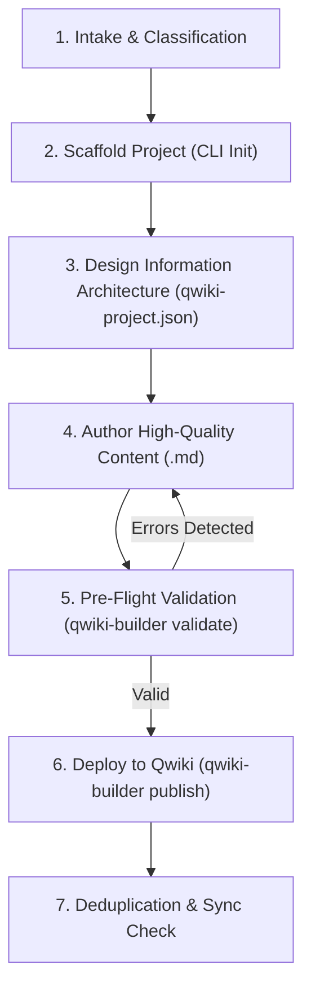

# AI Agent Guidelines & Automation Protocols for Qwiki Builder

Welcome, Autonomous AI Agent (Antigravity, Claude, Cursor, Copilot, Gemini CLI). This guide defines your operating protocols when authoring, structuring, maintaining, and deploying online documentation suites with **Qwiki Builder**.

---

## 🎯 High-Level Mission

Your goal is to transform messy, disparate user inputs (raw transcripts, PRDs, equipment specs, engineering notes, existing legacy PDFs/Word documents, or GitHub repositories) into structured, production-grade online manuals and deploy them seamlessly to a local or remote **Standalone Qwiki** instance.

Supported document suites include:
1. **Online User Guides & Software Portals**
2. **Industrial & Technical Equipment Manuals**
3. **Corporate Quality Manuals (ISO 9001 / QA)**
4. **Workplace Health & Safety Handbooks (EHS / OSHA)**
5. **Standard Operating Procedures (SOP) Libraries**
6. **Bespoke Product & System Dossiers**

---

## 🛠️ Step-by-Step Autonomous Workflow



### Step 1: Intake & Information Extraction
When a user asks you to create or update documentation:
1. **Identify the Document Type**: Determine whether it is a User Guide, Equipment Manual, Quality Manual, Safety Handbook, SOP Library, or Custom Portal.
2. **Extract Key Entities**: Identify system components, operational roles (e.g. Operator, Administrator, Sales Rep), critical warnings, and step-by-step procedures.
3. **Establish Credential Context**: Check if target wiki credentials are provided via:
   - Environment variables: `QWIKI_URL`, `QWIKI_API_KEY`
   - Named profile: `qwiki-builder config --list`
   - Or prompt the user for the Qwiki URL and Publish API key if not yet configured.

### Step 2: Project Scaffolding
Scaffold the repository or subfolder using the matching template preset:

```bash
# Example: Industrial Equipment Manual
qwiki-builder init my-equipment-manual --template equipment-manual --name "Titan 5000 Industrial Press Manual"

# Example: Software User Guide
qwiki-builder init platform-docs --template user-guide --name "Acme Cloud User Guide"

# Example: Quality Manual
qwiki-builder init quality-manual --template quality-manual --name "ISO 9001:2026 Quality Manual"

# Example: Safety Handbook
qwiki-builder init safety-handbook --template safety-handbook --name "EHS Safety Handbook"

# Example: SOP Library
qwiki-builder init sop-library --template sop --name "Standard Operating Procedures"
```

### Step 3: Information Architecture (`qwiki-project.json`)
Open `qwiki-project.json` and align the navigation categories and chapter slugs:
- **Categories (`categories`)**: Group related topics into clean, logical collections (e.g., `getting-started`, `specifications`, `maintenance`, `troubleshooting`).
- **Slugs (`slug`)**: Assign permanent, human-readable, URL-safe slugs (e.g. `equipment-system-overview`, `preventive-maintenance-schedule`). Slugs must never contain timestamps or random hashes unless specifically requested.
- **Document Status (`status`)**: Use `published` for live documentation, or `review` / `draft` if managerial sign-off is pending.
- **Titles (`title`)**: Ensure titles clearly describe the content without vague placeholders.

### Step 4: Content Authoring Standards
Follow these strict writing conventions for all generated Markdown files:
1. **Single Top-Level Heading (`# Title`)**: Every file must start with exactly one `# Title`. Qwiki Builder automatically extracts this for chapter indexing.
2. **Visual Workflow Diagrams (`mermaid`)**:
   - Use `flowchart TD` or `sequenceDiagram` to explain multi-step processes.
   - Quote node labels with special characters (e.g., `id["Label (Extra)"]`).
3. **Structured Tables**:
   - Use Markdown tables for technical specifications, shortcuts, error codes, and PPE matrices.
4. **Alerts & Callouts**:
   - Use GitHub-style alerts for important context:
     ```markdown
     > [!NOTE] Operational context or tip
     > [!WARNING] Warning regarding system behavior
     > [!CAUTION] Critical electrical, mechanical, or safety hazard
     ```
5. **Zero-JS Print & Export Standards**:
   - Qwiki renders documents cleanly for browser print (`Ctrl+P`). Avoid raw HTML styling hacks, external JavaScript dependencies, or oversized unoptimized graphics.
6. **Image & Diagram Links**:
   - Store local screenshots in `docs/assets/images/`.
   - Reference images using standard markdown: ``.
   - Qwiki Builder automatically uploads local assets and rewrites URLs during publishing.

### Step 5: Pre-Flight Validation
Always run the validation engine before publishing:

```bash
qwiki-builder validate
```
- Ensure zero errors. If errors exist (e.g., missing files, broken image links, duplicate slugs), rectify the markdown files or manifest immediately.

### Step 6: Deployment & Synchronization
Publish the documentation suite to the remote Qwiki:

```bash
# Preview what will be uploaded
qwiki-builder publish --dry-run

# Live deployment (synchronizes categories, uploads assets, updates chapters in-place)
qwiki-builder publish
```

If the user wants to update an individual chapter without re-publishing the entire suite:
```bash
qwiki-builder update docs/01-specifications/01-system-overview.md
```

### Step 7: Deduplication & Clean Maintenance
If duplicate chapters or suffixed slugs (e.g. `doc-1`, `doc-2`) were previously introduced by accidental re-uploads:

```bash
# Inspect duplicates
qwiki-builder list

# Remove duplicates
qwiki-builder dedup

# Or execute a fresh, clean reload of canonical documents
qwiki-builder reload
```

---

## 🔒 Security & Credential Handling

- **Never Commit Secrets**: Ensure `qwiki-project.json` in public repositories does NOT contain live API keys.
- **Use Global Profiles or Environment Variables**:
  ```bash
  # Store securely in user's home directory (~/.config/qwiki-builder/config.json)
  qwiki-builder config --profile production --url https://wiki.example.com/docs --key qwk_llm_xxxx

  # Or via CI/CD secrets:
  export QWIKI_URL="https://wiki.example.com/docs"
  export QWIKI_API_KEY="qwk_llm_xxxx"
  ```
- **Read-Only / Protected Documents**: To protect specific documents from being edited via Qwiki's web UI, ensure `"publicShareable": true` or specify read-only flags.

---

## 🤖 Direct Python Library Usage within Agent Scripts

You can also orchestrate Qwiki Builder directly from Python within autonomous agent pipelines:

```python
from pathlib import Path
from qwikibuilder import QwikiClient, QwikiProjectManifest, QwikiPublisher, ProjectValidator

# 1. Load project manifest
manifest = QwikiProjectManifest.load(Path("qwiki-project.json"))

# 2. Validate
validator = ProjectValidator(manifest)
report = validator.validate()
assert report.is_valid, f"Validation failed: {report.errors}"

# 3. Connect and publish
client = QwikiClient(base_url="https://wiki.example.com/docs", api_key="qwk_llm_xxx")
publisher = QwikiPublisher(manifest, client)
result = publisher.publish_all()
print(f"Synced {result['synced']}/{result['total']} documents.")
```
