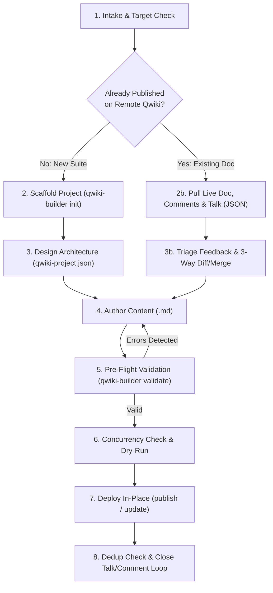

# AI Agent Guidelines & Automation Protocols for Qwiki Builder

Welcome, Autonomous AI Agent (Antigravity, Claude, Cursor, Copilot, Gemini CLI). This guide defines your operating protocols when authoring, structuring, maintaining, and deploying online documentation suites with **Qwiki Builder**.

---

## 🎯 High-Level Mission

Your goal is to transform messy, disparate user inputs (raw transcripts, PRDs, equipment specs, engineering notes, existing legacy PDFs/Word documents, or GitHub repositories) into structured, production-grade online manuals and deploy them seamlessly to a local or remote **Standalone Qwiki** instance.

Supported document suites include:
1. **Online User Guides & Software Portals**
2. **Industrial & Technical Equipment Manuals**
3. **Corporate Quality Manuals (ISO 9001 / QA)**
4. **Workplace Health & Safety Handbooks (EHS / OSHA)**
5. **Standard Operating Procedures (SOP) Libraries**
6. **Bespoke Product & System Dossiers**

---

## 🛠️ Step-by-Step Autonomous Workflow



### Step 1: Intake & Information Extraction
When a user asks you to create or update documentation:
1. **Identify the Document Type**: Determine whether it is a User Guide, Equipment Manual, Quality Manual, Safety Handbook, SOP Library, or Custom Portal.
2. **Extract Key Entities**: Identify system components, operational roles (e.g. Operator, Administrator, Sales Rep), critical warnings, and step-by-step procedures.
3. **Establish Credential Context**: Check if target wiki credentials are provided via:
   - Environment variables: `QWIKI_URL`, `QWIKI_API_KEY`
   - Named profile: `qwiki-builder config --list`
   - Or prompt the user for the Qwiki URL and Publish API key if not yet configured.

### Step 2: Project Scaffolding
Scaffold the repository or subfolder using the matching template preset:

```bash
# Example: Industrial Equipment Manual
qwiki-builder init my-equipment-manual --template equipment-manual --name "Titan 5000 Industrial Press Manual"

# Example: Software User Guide
qwiki-builder init platform-docs --template user-guide --name "Acme Cloud User Guide"

# Example: Quality Manual
qwiki-builder init quality-manual --template quality-manual --name "ISO 9001:2026 Quality Manual"

# Example: Safety Handbook
qwiki-builder init safety-handbook --template safety-handbook --name "EHS Safety Handbook"

# Example: SOP Library
qwiki-builder init sop-library --template sop --name "Standard Operating Procedures"
```

### Step 2b: Pull Live State Before Amending Published Documents (Mandatory for Updates)
Whenever a target chapter is **already published** on Standalone Qwiki (verify first with `qwiki-builder list` or `qwiki-builder diff <file-or-slug>`), **never** edit and re-upload solely from local files. Users may have edited the document directly in the Qwiki UI, uploaded new media into `uploads/`, modified chapter status/metadata, or added feedback in **Comments** (`tool-comments`) and the **Talk Page** (`tool-talk`).

1. **Pull Live Document, Comments & Talk Page (or Full Tree Discovery)**:
   ```bash
   # Compare full live remote wiki tree vs local manifest (new categories, new pages, moves, deletions, modifications)
   qwiki-builder status

   # Inspect differences, metadata drift, active lock, and discussion counts for a single chapter (read-only)
   qwiki-builder diff <file-or-slug>

   # Pull live content + sidecar feedback + SHA-256 baseline (add --sync-meta to align title/status/description)
   qwiki-builder pull <file-or-slug> --sync-meta

   # Or pull the entire suite AND automatically discover new categories/pages/forms added on the live wiki:
   qwiki-builder pull --all

   # Or run a full bidirectional sync (pull tree + 3-way merge + validate + publish local changes):
   qwiki-builder sync
   ```
   - `qwiki-builder pull --all` calls `api/publish.php?action=get_tree` and `action=get_doc`, which retrieves **verbatim Markdown, HTML, and `.form.json` schemas** across all lifecycle statuses (`published`, `review`, `draft`, `archived`), active `LockManager` editor lock state, `docId`, `sha256`, `comments`, and `talk`.
   - It matches chapters by immutable `docId` (`doc_id` in `qwiki-project.json`), so if a live user renamed a slug or moved a page into another category, `qwiki-builder pull` relocates the local file and updates `qwiki-project.json` without duplicating the page.
   - It saves the remote `sha256` and 3-way merge base under `.qwiki-sync/state.json` and `.qwiki-sync/base/`, and writes live discussions to `.qwiki-sync/feedback/<bookId>__<slug>.feedback.md` (and `.json`) so internal comments and Talk threads are **never** concatenated into your document file.
   - **Legacy Server Fallback**: If the remote Standalone Qwiki is an older version without `action=get_doc`, `pull` automatically falls back to `api/llm.php?mode=doc&slug=<slug>&include_comments=1&include_talk=1` (JSON mode—note that `api/llm.php` strips HTML tags on `type=html`, hides `draft`/`archived` chapters, and rewrites relative URLs to absolute URLs, so export raw source from the Qwiki UI for HTML/drafts on older servers).

2. **Triage Comments & Talk Page Feedback**:
   Read `.qwiki-sync/feedback/<bookId>__<slug>.feedback.md` (or `.feedback.json`) separately from the document content:
   - Classify each open comment/Talk topic as: **(a) Actionable amendment**, **(b) Clarification needed from user**, or **(c) Already resolved / out of scope**.
   - Check whether any live-uploaded media (`uploads/images/...`, `uploads/videos/...`) was added by UI editors—preserve those references (`qwiki-builder validate` automatically skips missing-on-disk warnings for `uploads/...` paths).

3. **3-Way Diff & Merge (`Base` vs `Local` vs `Remote`)**:
   - If you have unpushed local edits and the remote file also changed since the last synced base, `pull` attempts a clean `diff3` auto-merge; if edits overlap, it keeps your local file intact and writes the remote copy to `.qwiki-sync/conflicts/<bookId>__<slug>.remote.<ext>` with exit code `1` so nothing is clobbered.
   - Preserve legitimate live user edits (typo fixes, added examples, UI formatting adjustments) alongside your new amendments and triaged Comments/Talk resolutions.
   - **Preserve Chapter Identity**: Keep `category` (`bookId`), `slug`, and `shareKey` unchanged in `qwiki-project.json`. Comments (`data/comments/{bookId}__{slug}.json`) and Talk pages (`data/talk/{bookId}__{slug}.talk.md`) are keyed by `{bookId}__{slug}`, so renaming a slug or moving categories without migrating them will orphan discussions.

### Step 3: Information Architecture (`qwiki-project.json`)
Open `qwiki-project.json` and align the navigation categories and chapter slugs:
- **Categories (`categories`)**: Group related topics into clean, logical collections (e.g., `getting-started`, `specifications`, `maintenance`, `troubleshooting`).
- **Slugs (`slug`)**: Assign permanent, human-readable, URL-safe slugs (e.g. `equipment-system-overview`, `preventive-maintenance-schedule`). Slugs must never contain timestamps or random hashes unless specifically requested.
- **Document Status (`status`)**: Use `published` for live documentation, or `review` / `draft` if managerial sign-off is pending.
- **Titles (`title`)**: Ensure titles clearly describe the content without vague placeholders.

### Step 4: Content Authoring Standards
Follow these strict writing conventions for all generated Markdown files:
1. **Single Top-Level Heading (`# Title`)**: Every file must start with exactly one `# Title`. Qwiki Builder automatically extracts this for chapter indexing.
2. **Visual Workflow Diagrams (`mermaid`)**:
   - Use `flowchart TD` or `sequenceDiagram` to explain multi-step processes.
   - Quote node labels with special characters (e.g., `id["Label (Extra)"]`).
3. **Structured Tables**:
   - Use Markdown tables for technical specifications, shortcuts, error codes, and PPE matrices.
4. **Alerts & Callouts**:
   - Use GitHub-style alerts for important context:
     ```markdown
     > [!NOTE] Operational context or tip
     > [!WARNING] Warning regarding system behavior
     > [!CAUTION] Critical electrical, mechanical, or safety hazard
     ```
5. **Zero-JS Print & Export Standards**:
   - Qwiki renders documents cleanly for browser print (`Ctrl+P`). Avoid raw HTML styling hacks, external JavaScript dependencies, or oversized unoptimized graphics.
6. **Visual Media & Documentation Assets (Screenshots, Generated Graphics & Videos)**:
   - **Never produce walls of dry text alone** when visual illustration adds cognitive clarity or operational value.
   - **Canonical Production Reference**: Look at `/Documents/MobioPlus/user-docs` deployed to `https://wiki.mobioplus.co.za/user-docs` (e.g., `01-operational-guide/01-geocrm/01-overview-and-navigation.md`). This suite includes full-resolution user interface captures and zoomed workflow inspections (`crm_map_preview.png`, `crm_map_zoomed_preview.png`) uploaded to `uploads/images/` and seamlessly rendered in the documentation.
   - **Supported Media Types**:
     - **Screenshots & UI Mockups**: `.png`, `.jpg`, `.jpeg`, `.webp`, `.svg`, `.gif`. Store locally in `docs/assets/images/`.
     - **Generated Graphics & Diagrams**: Complex architectural topologies, flowcharts, and system schematics generated as images or SVGs. Store locally in `docs/assets/images/`.
     - **Video Screencasts & Demos**: `.mp4`, `.webm`, `.ogg`, `.ogv`, `.mov`. Store locally in `docs/assets/videos/`. Standalone Qwiki also natively supports external links from YouTube, Vimeo, and Loom.
   - **Markdown Media Syntax**:
     - Images & Screenshots:
       ```markdown
       
       ```
     - Auto-Embedded HTML5 Video Player (local MP4/WebM):
       ```markdown
       [Feature Walkthrough Video](assets/videos/feature-walkthrough.mp4)
       ```
       or
       ```markdown
       
       ```
     - External Hosted Video Embeds:
       Place standalone YouTube, Vimeo, or Loom URLs on their own line with blank lines before and after:
       ```markdown
       https://www.youtube.com/watch?v=dQw4w9WgXcQ

       [Loom Walkthrough](https://www.loom.com/share/d46d0a7a40b3438ea238e8ba73a9042c)
       ```
   - **Automated In-Place Upload & URL Rewriting**:
     - Author documents using local asset references (e.g., `assets/images/...`, `assets/videos/...`).
     - During `qwiki-builder publish` (or `qwiki-builder upload-assets`), Qwiki Builder automatically uploads new or modified files via Qwiki's headless REST API (`action=upload_image` / `upload_asset`).
     - Asset paths in Markdown and HTML (``, `<video>`, `<source>`) are automatically rewritten to permanent remote URLs (e.g. `uploads/images/1792-overview.png`, `uploads/videos/1792-demo.mp4`).
     - Qwiki Builder caches asset timestamps in `.uploaded_assets.json` to prevent unnecessary re-uploads.
7. **Custom Theme Stylesheets for Markdown Rendering (`theme-*.css`)**:
   - **Naming & Scoping Rules**:
     - Theme filenames must follow Standalone Qwiki's convention: `theme-<name>.css` (alphanumeric and hyphens only, e.g., `theme-technical-manual.css`).
     - **Mandatory CSS Scoping:** Custom stylesheets intended for Markdown rendering **must scope selectors to `.content-body`** (and `@media print` if print styling is needed) so they don't inadvertently alter the sidebar, toolbar, or Toast UI editor layout.
     - Example:
       ```css
       .content-body h2 {
           border-bottom: 2px solid var(--accent-color);
           padding-bottom: 0.35rem;
       }
       .content-body table {
           font-size: 0.92rem;
       }
       @media print {
           .content-body { font-size: 10.5pt; }
       }
       ```
   - **3-Tier Hierarchy (`page` ➔ `category` ➔ `site`)**:
     - Set `"theme"` at the root of `qwiki-project.json` (site-wide), on any entry in `"categories"` (category-wide), or on any entry in `"documents"` (page-specific). Values can be a built-in/remote theme name (e.g., `"theme-article-modern.css"`) or a local file path (e.g., `"docs/assets/themes/theme-custom.css"`), which `qwiki-builder publish` / `update` automatically validates and uploads.
   - **CLI Theme Management**:
     ```bash
     qwiki-builder theme list
     qwiki-builder theme get theme-article-modern.css -o docs/assets/themes/theme-custom.css
     qwiki-builder theme upload docs/assets/themes/theme-custom.css
     qwiki-builder theme apply theme-custom.css --category getting-started
     qwiki-builder theme apply docs/assets/themes/theme-custom.css --slug system-overview
     ```
8. **JSON Web Forms (`.form.json`) & Response Monitoring**:
   - **Authoring & Schema Format**:
     - Store form definitions locally as `docs/<category>/<slug>.form.json` with `"type": "form"` in `qwiki-project.json`.
     - Supported field types: `text`, `email`, `textarea`, `select`, `radio`, `checkbox`, `number`, `date`, `tel`, `url` (`select` and `radio` require a non-empty `"options": [...]` array).
     - Optional real-time push notifications inside `.form.json`: set `"webhookUrl": "https://..."` (receives instant HTTP POST JSON payload on submission) or `"notificationEmail": "ops@example.com"`.
   - **CLI Form Automation & Response Monitoring**:
     ```bash
     # List all forms on remote wiki with field counts, submission counts, and latest timestamp
     qwiki-builder forms list

     # Create or replace a form schema in-place (existing .submissions.json responses are preserved!)
     qwiki-builder forms push docs/general/feedback-survey.form.json --category general

     # Fetch or export responses as a Markdown table, JSON, or Excel-ready CSV
     qwiki-builder forms responses feedback-survey
     qwiki-builder forms responses feedback-survey --format csv -o responses.csv
     qwiki-builder forms responses feedback-survey --since "2026-11-20 00:00:00" --format json

     # Live-monitor a form in the terminal for new incoming submissions
     qwiki-builder forms watch feedback-survey --interval 15

     # Delete a single response or clear all responses
     qwiki-builder forms delete-response feedback-survey --id sub_a1b2c3d4e5f6
     qwiki-builder forms clear-responses feedback-survey
     ```

### Step 5: Pre-Flight Validation
Always run the validation engine before publishing or updating:

```bash
qwiki-builder validate
```
- Ensure zero errors. If errors exist (e.g., missing files, broken image links, duplicate slugs), rectify the markdown files or manifest immediately. (Remote server `uploads/...` references preserved from live UI edits are automatically recognized without missing-asset warnings.)

### Step 6: Concurrency Check, Metadata Alignment & Dry-Run
Before pushing an update to an already-published chapter:
1. **Automated Optimistic Concurrency & Lock Guard**: When a chapter was pulled or previously published via `qwiki-builder`, its remote `sha256` is tracked in `.qwiki-sync/state.json`. Both `qwiki-builder update` and `qwiki-builder publish` automatically pass `expectedSha256` to `api/publish.php`.
   - If another collaborator edited the page on the live wiki after your `pull`, the server returns `HTTP 409 (CONFLICT_SHA256_MISMATCH)`. Run `qwiki-builder diff <slug>` and `qwiki-builder pull <slug>` to merge before pushing.
   - If a collaborator currently holds an active UI editor lease (`LockManager`), the server returns `HTTP 423 (LOCKED_BY_OTHER)`. Wait for them to finish or pass `--force` only if an intentional override is required.
2. **Prevent Metadata Drift**: Confirm that `title`, `description`, `status` (`published` / `review` / `draft`), `category`, and `share_key` in `qwiki-project.json` match any intentional live changes made by administrators/reviewers (or pull with `--sync-meta`).
3. **Preview Deployment**:
   ```bash
   # Preview single-chapter update or full-suite sync without modifying remote server
   qwiki-builder update docs/01-specifications/01-system-overview.md --dry-run
   # Or for the entire suite:
   qwiki-builder publish --dry-run
   ```

### Step 7: In-Place Deployment & Synchronization
Deploy changes in-place (Standalone Qwiki's `DocumentService::replaceContent()` automatically captures a pre-write revision snapshot in `data/revisions/{docId}/` when `tool-revisions` is enabled):

```bash
# Preferred for single-chapter amendments (avoids touching unrelated live-edited chapters):
qwiki-builder update docs/01-specifications/01-system-overview.md

# Or synchronize the entire documentation suite:
qwiki-builder publish
```

### Step 8: Deduplication, Safe Maintenance & Closing the Feedback Loop
1. **Deduplication & Clean Reload Guardrails**:
   If duplicate chapters or suffixed slugs (e.g. `doc-1`, `doc-2`) were introduced:
   ```bash
   # Inspect duplicates
   qwiki-builder list

   # Preview and remove only accidental duplicates
   qwiki-builder dedup --dry-run
   qwiki-builder dedup
   ```
   > [!WARNING]
   > **Never run `qwiki-builder reload` on a wiki with live user edits, active Comments, or Talk Page discussions** unless you have intentionally backed up and reconciled everything first. `reload` purges and recreates all chapters in target categories, wiping live chapter metadata and risking orphaned `data/comments/` and `data/talk/` associations if slugs or categories change.

2. **Close the Talk Page & Comments Loop**:
   - Because `qwk_llm_...` API keys are **read-only** for Comments (`tool-comments`) and Talk pages (`tool-talk`), automated agents cannot post replies or resolve Talk topics directly via `api/llm.php`.
   - After re-uploading the amended document, provide the user/editor with a concise **Feedback Resolution Summary** listing each comment and Talk topic addressed (and any items intentionally deferred), so an authenticated editor/admin can reply in the Qwiki UI or archive resolved Talk topics. This prevents future update cycles from re-applying already-resolved feedback.

---

## 🔒 Security & Credential Handling

- **Never Commit Secrets**: Ensure `qwiki-project.json` in public repositories does NOT contain live API keys.
- **Use Global Profiles or Environment Variables**:
  ```bash
  # Store securely in user's home directory (~/.config/qwiki-builder/config.json)
  qwiki-builder config --profile production --url https://wiki.example.com/docs --key qwk_llm_xxxx

  # Or via CI/CD secrets:
  export QWIKI_URL="https://wiki.example.com/docs"
  export QWIKI_API_KEY="qwk_llm_xxxx"
  ```
- **Read-Only / Protected Documents**: To protect specific documents from being edited via Qwiki's web UI, ensure `"publicShareable": true` or specify read-only flags.

---

## 🤖 Direct Python Library Usage within Agent Scripts

You can also orchestrate Qwiki Builder directly from Python within autonomous agent pipelines:

```python
from pathlib import Path
from qwikibuilder import QwikiClient, QwikiProjectManifest, QwikiPublisher, ProjectValidator

# 1. Load project manifest
manifest = QwikiProjectManifest.load(Path("qwiki-project.json"))

# 2. Validate
validator = ProjectValidator(manifest)
report = validator.validate()
assert report.is_valid, f"Validation failed: {report.errors}"

# 3. Connect and publish
client = QwikiClient(base_url="https://wiki.example.com/docs", api_key="qwk_llm_xxx")
publisher = QwikiPublisher(manifest, client)
result = publisher.publish_all()
print(f"Synced {result['synced']}/{result['total']} documents.")
```
