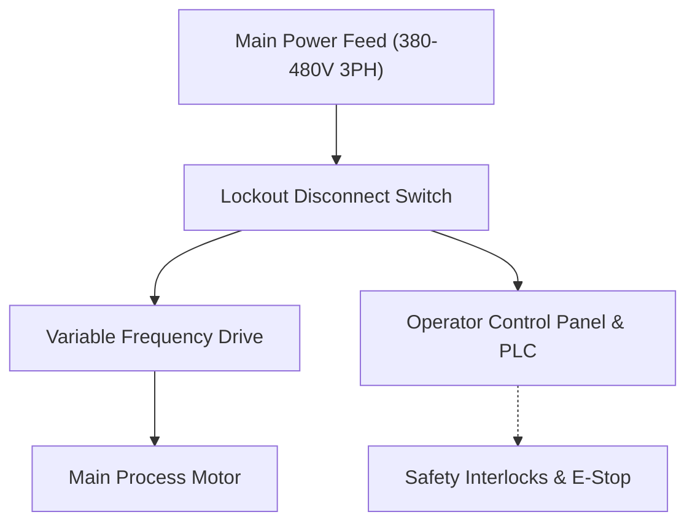

# Equipment Overview & Component Architecture

This manual establishes operational, safety, and servicing standards for the machine. Read all sections thoroughly before installation, commissioning, or maintenance.

## Main Assembly Layout

The system comprises three primary modules:
1. **Primary Drive Unit**: Houses the electric motor, speed reducer, and primary drive coupling.
2. **Process Chamber**: Stainless steel chamber featuring automated safety interlocks and inspection ports.
3. **Control Enclosure (HMI)**: Industrial IP65 rated operator touchscreen and emergency stop circuit.

## Intended Purpose

This machine is engineered for controlled continuous industrial throughput under specified temperature and load parameters. Operation outside rated tolerances voids manufacturer warranty.
