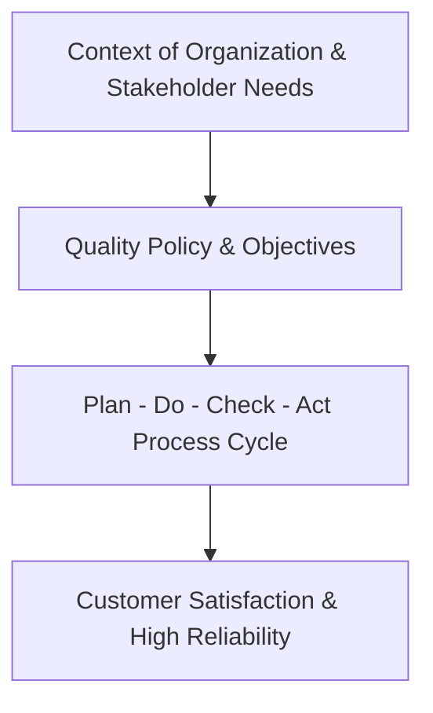

# Quality Policy, Context & Scope of Certification

## 1. Executive Quality Statement

Our organization is committed to providing defect-free products and services that consistently exceed customer expectations and fulfill all applicable statutory and regulatory requirements. We foster a culture of evidence-based decision-making and continuous process improvement.

## 2. Scope of the Quality Management System (QMS)

This Quality Manual governs all operations relating to:
- Design, development, and system architecture.
- Supply chain qualification and materials verification.
- Production, assembly, and testing.
- Post-delivery technical support, warranty, and field service.

## 3. Document Control Hierarchy

1. **Level 1**: Quality Manual (this document).
2. **Level 2**: Standard Operating Procedures (SOPs).
3. **Level 3**: Work Instructions & Testing Specifications.
4. **Level 4**: Quality Records, Calibration Logs, and Traceability Forms.
