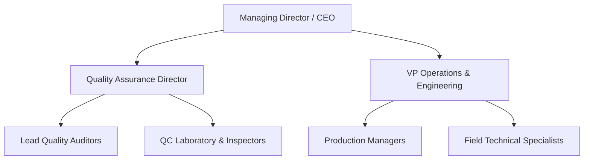

# Leadership Commitment, Roles & Responsibilities

Top management demonstrates active leadership and commitment to the Quality Management System (QMS).

## Organizational Structure

## Key Quality Responsibilities

| Role | Primary Accountability |
| :--- | :--- |
| **Quality Director** | QMS design, regulatory compliance, external registrar audits |
| **Operations VP** | Resource allocation, manufacturing process integrity |
| **Lead Auditor** | Independent internal audits, CAPA follow-up verification |
| **All Employees** | Adherence to procedures, reporting non-conformances immediately |
