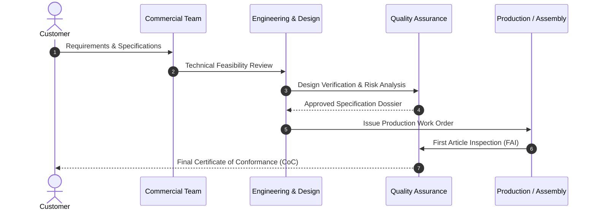

# Core Operational Process & Value Stream Map

This section outlines the end-to-end realization cycle from customer intake through validation, delivery, and post-release support.

## Process Flow Diagram

## Traceability & Lot Control

Each finished unit or batch carries a unique serial number / lot identifier traceable to raw material certifications, calibration stamps, and inspector sign-offs.
