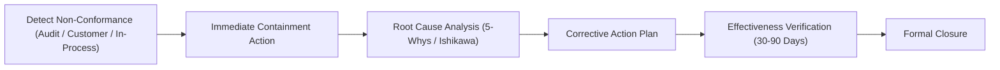

# Performance Evaluation, Auditing & Corrective Actions

Continuous improvement ensures systemic risks are mitigated before causing customer dissatisfaction or non-conformance.

## Corrective and Preventive Action (CAPA) Workflow

## Management Review Meetings

Executive leadership convenes bi-annually to review:
- Audit findings (internal and registrar).
- Customer feedback, warranties, and return trends.
- Process KPI performance against annual quality targets.
- Adequacy of resources and preventive opportunities.
