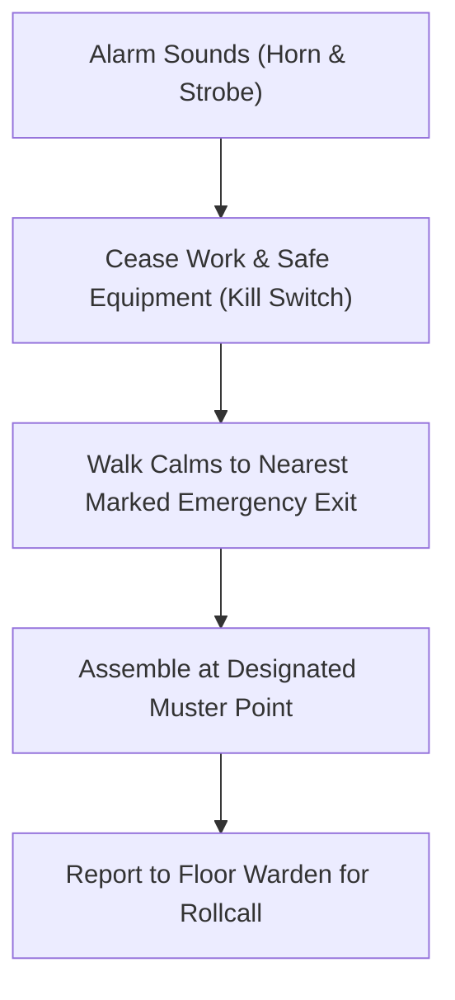

# Emergency Response, Evacuation & First Aid

In any emergency, protecting human life is the top priority.

## Fire & Evacuation Procedure

## Emergency Numbers & Muster Zones

- **Internal Security / First Aid**: Extension `3333`
- **External Emergency (Fire / Police / Ambulance)**: `112` or `911`
- **Muster Point A**: South Parking Lot (Adjacent to Visitor Gate)
- **Muster Point B**: North Lawn (Adjacent to Shipping Dock)

> [!IMPORTANT]
> Never re-enter an evacuated building until the Incident Commander issues the all-clear announcement.
