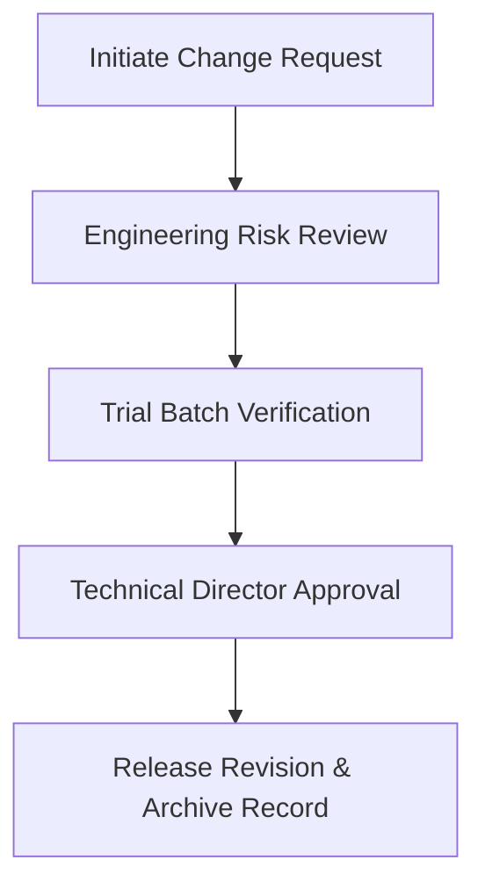

# SOP-101: Engineering & Operational Change Control

| Document ID | SOP-101 | Version | 1.4 |
| :--- | :--- | :--- | :--- |
| **Effective Date** | 2026-10-15 | **Review Cycle** | Annual |
| **Owner** | Process Engineering | **Approver** | Technical Director |

## 1. Purpose

Establishes a rigorous Change Control Notice (CCN) protocol to prevent unverified alterations to machinery settings, software parameters, or chemical formulations.

## 2. Change Classification

- **Minor Change**: Tooling replacement with identical manufacturer specifications. Requires Shift Supervisor sign-off.
- **Major Change**: Setpoint adjustments, software updates, or component supplier substitution. Requires Engineering Review, Safety Sign-off, and Trial Batch Validation.

