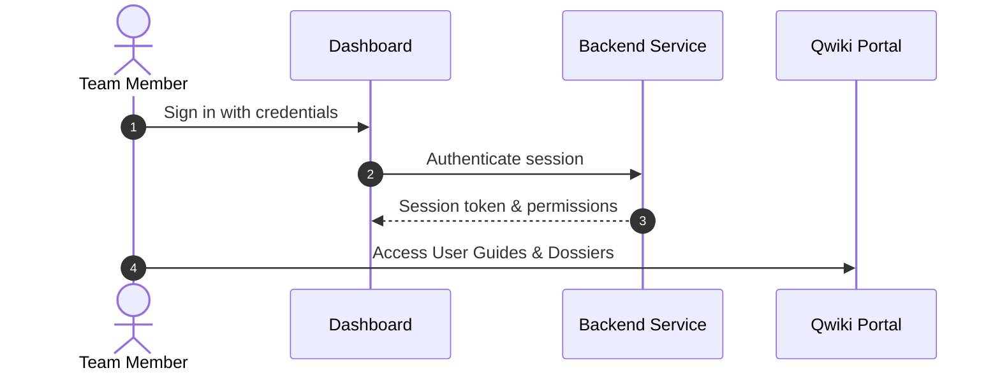

# Quick Start Guide & Onboarding

Follow these straightforward steps to set up your account and begin using the system.

## 1. Sign In to Your Workspace

1. Open your browser and navigate to the application URL.
2. Enter your assigned username and temporary password.
3. If prompted, complete two-factor authentication (2FA).

## 2. Setting Up Your Profile

- Navigate to **Account Settings**.
- Verify your verified email address for notifications.
- Update your notification preferences.

## 3. Recommended Workflow

> [!TIP]
> Bookmark this documentation portal for immediate offline or mobile access during fieldwork.
