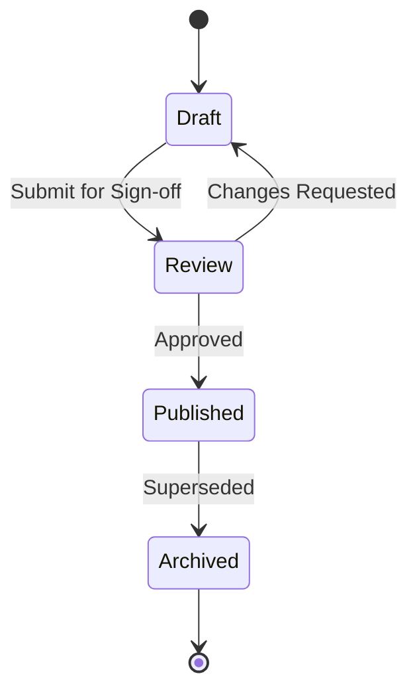

# Resource Management & Collaboration

Efficient resource allocation ensures operational alignment across departments and field personnel.

## Lifecycle States

Every asset and document moves through defined lifecycle states:

1. **Draft**: Initial authoring state. Visible only to editors.
2. **Review**: Locked for editorial review and technical sign-off.
3. **Published**: Available to all authorized staff and public recipients.
4. **Archived**: Superseded by newer revisions.

